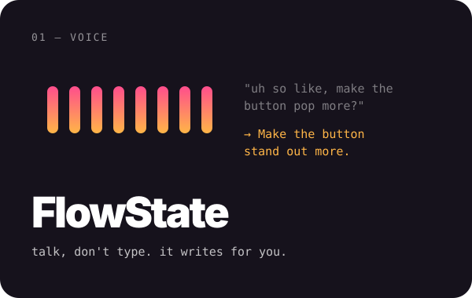
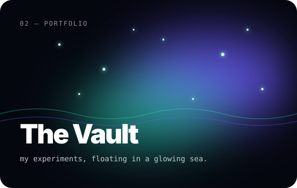
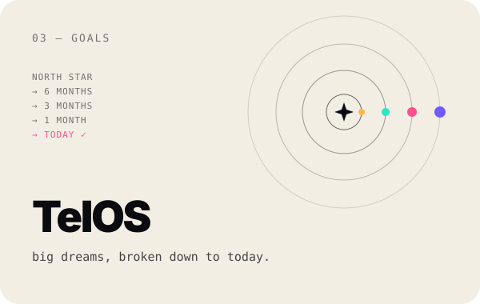
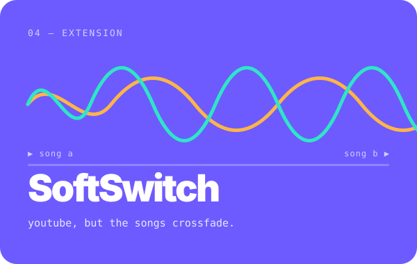
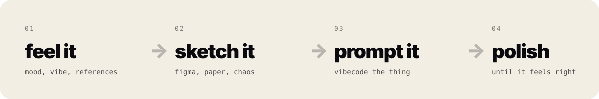

 

  hi, i'm <b>pelsynergy</b> — a designer who builds by vibe. 
  i care about how things <i>feel</i>: the bounce, the glow, the tiny click. 
  then i prompt them into real, working things.

 

<h3 align="center">✦ things i've made ✦</h3>

  
  
  
  

click a card to open it ↗

 

<h3 align="center">✦ how i work ✦</h3>

  

  made with taste, too many prompts & zero chill ✦ pelsynergy

